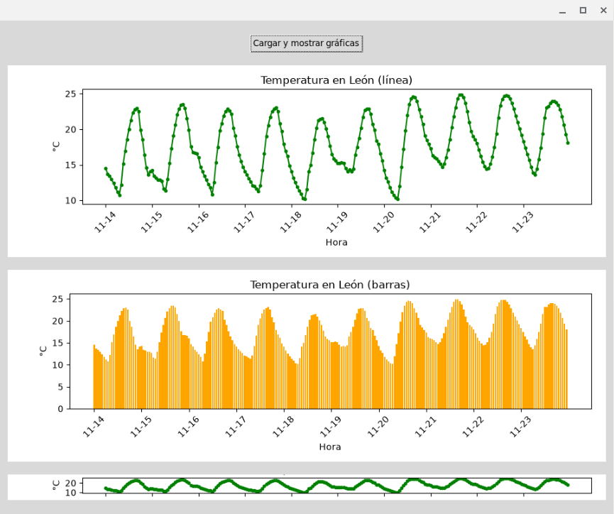

# Cambios en win_canvas.py - Mateo Sanchez

## Cambios realizados
- Cambié el color de la gráfica de línea a verde (color="green").
- Cambié el color de las barras a naranja (color="orange").
- Amplié el rango de consulta de la API de past_days=1 a past_days=3.
- Limpié el eje X mostrando una etiqueta por día en lugar de todas las horas y agregue una linea de dispercion 

## Captura

